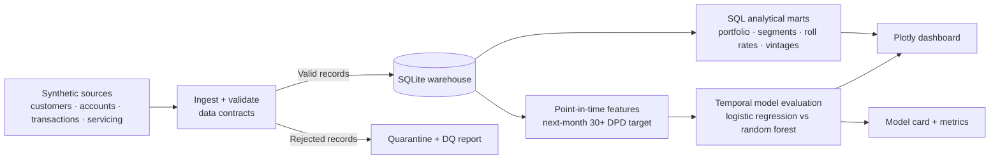

<div align="center">

# 🏦 BankPulse
### Retail Banking Risk & Customer Intelligence Platform

**From synthetic banking events to trustworthy portfolio intelligence and next-month delinquency alerts.**

[](https://github.com/Datamathican/bankpulse-retail-risk-platform/actions/workflows/ci.yml)


[**Explore the dashboard**](demo/sample_dashboard.html) · [**Architecture**](docs/architecture.md) · [**Data dictionary**](docs/data_dictionary.md) · [**Model card**](demo/model_card_sample.md) · [**CI results**](https://github.com/Datamathican/bankpulse-retail-risk-platform/actions)

</div>


> **Project scope:** This is a reproducible, local-first **synthetic-data demonstration**, not a deployed bank system. It uses no real customer records, employer information or regulated credit decisions. Reported results reflect the simulator and must not be interpreted as real-world predictive performance.

## Overview

Retail risk teams need to answer three connected questions: **How is the portfolio performing? Where is arrears risk emerging? Can the underlying data be trusted?** BankPulse brings these together in one reproducible workflow: generate four fictional source feeds, enforce data contracts, build SQL analytical marts, evaluate an early-warning classifier using chronological splits, and publish interactive portfolio dashboards.

| Layer | What is implemented | Evidence |
|:--|:--|:--|
| **Data engineering** | CSV ingestion, schema/relationship checks, invalid-row quarantine and SQLite loading | [`src/bankpulse/pipeline.py`](src/bankpulse/pipeline.py), [`src/bankpulse/quality.py`](src/bankpulse/quality.py) |
| **Analytics engineering** | SQL portfolio, segment, roll-rate and vintage views | [`sql/01_analytics_marts.sql`](sql/01_analytics_marts.sql) |
| **Business analytics** | Exposure, 30+ days-past-due (DPD), account movements and customer segments | [Sample dashboard](demo/sample_dashboard.html), [sample portfolio series](demo/portfolio_monthly_sample.csv) |
| **Data science** | Point-in-time features; logistic regression vs random forest; chronological holdout | [`src/bankpulse/model.py`](src/bankpulse/model.py), [sample metrics](demo/model_metrics_sample.json) |
| **Governance & quality** | Dictionary, lineage, quality results and documented limitations | [`docs/data_dictionary.md`](docs/data_dictionary.md), [`docs/lineage.json`](docs/lineage.json) |
| **Reliability** | Automated tests and GitHub Actions across Python 3.11 and 3.13 | [`tests/`](tests/), [CI workflow](.github/workflows/ci.yml) |

## Architecture



### Business questions

1. How do **exposure and arrears** evolve by reporting month?
2. Which **products and regions** show higher observed 30+ DPD rates?
3. How do accounts **move between delinquency buckets** month to month?
4. Can we identify accounts currently below 30 DPD that are at greater risk of **first reaching 30+ DPD next month**?
5. Which source-quality failures could undermine the reliability of these metrics?

## Evidence from the included sample run

The repository includes a **small, version-controlled example run** under [`demo/`](demo/). These numbers belong to that sample configuration; rerunning the default 1,200-customer, 30-month simulation produces different volumes and metrics.

| Measure | Sample output | Interpretation |
|:--|--:|:--|
| Clean customers | **250** | Accepted customer records |
| Clean accounts | **307** | Accepted account records |
| Clean transactions | **23,206** | Accepted transaction records |
| Clean servicing rows | **3,871** | Accepted servicing snapshots |
| Distinct quarantined rows | **8** | Invalid records isolated from clean tables |
| Selected classifier | **Random forest** | Chosen from validation performance |
| Held-out test observations | **782** | Chronologically separated test set |
| Held-out ROC AUC | **0.590** | Modest discrimination on this synthetic sample |
| Held-out average precision | **0.100** | Must be considered against the 7.29% test event rate |
| Alert precision / recall | **13.1% / 31.6%** | Threshold-dependent trade-off; not production-calibrated |

Sources: [`demo/data_quality_sample.json`](demo/data_quality_sample.json) and [`demo/model_metrics_sample.json`](demo/model_metrics_sample.json). **These results do not demonstrate real-world lending suitability.** The sample model is intentionally evaluated on later months, not a random row split.

### Example: portfolio movement

The [sample monthly portfolio table](demo/portfolio_monthly_sample.csv) provides monthly account counts, exposure, 30+ DPD incidence and next-month events. For example, the sample's observed 30+ DPD account rate moves from **2.22% in January 2024** to **11.57% in July 2024**. This is a *simulated descriptive trend*, not evidence of a real market deterioration or a causal effect.

### Model design and controls

- **Target:** first transition to 30+ DPD in the following calendar month, for accounts currently below 30 DPD.
- **Inputs:** balance, utilisation, payment ratio, transaction flows, recent late/returned payments, previous DPD and account/customer characteristics.
- **Validation:** chronological training, validation and test periods; test months are kept separate from model selection.
- **Comparisons:** logistic regression and random forest, with ROC AUC and average precision; additional test metrics include Brier score and alert precision/recall.
- **Limitations:** synthetic labels and feature relationships; no causal claims, production deployment, regulatory PD estimation or IFRS 9 use.

Read the [sample model card](demo/model_card_sample.md) for methodology and limitations.

## Reproduce the project

**Prerequisites:** Python 3.10+ and a terminal. No cloud account, API key or external database server required.

```bash
# Clone or download the repository, then enter its folder
git clone https://github.com/Datamathican/bankpulse-retail-risk-platform.git
cd bankpulse-retail-risk-platform

# macOS / Linux
python3 -m venv .venv
source .venv/bin/activate
python -m pip install -r requirements.txt

# Quick end-to-end run
python run.py all --customers 250 --months 16

# Run automated tests
python -m pytest -q

# Open the generated dashboard on macOS
open dashboard/index.html
```

**Windows PowerShell:** replace environment setup with `py -m venv .venv` and `.venv\Scripts\Activate.ps1`; open `dashboard/index.html` in your browser. If you are already in the repository folder, **do not run commands from your home directory**: `run.py` must be visible when you execute `ls` or `dir`.

For the full default simulation:

```bash
python run.py all
```

### Outputs generated locally

| File | Purpose |
|:--|:--|
| `data/raw/*.csv` | Reproducible fictional source datasets |
| `warehouse/bankpulse.sqlite` | Validated SQLite warehouse and SQL views |
| `reports/data_quality.json` | Contract failures and quarantined-row counts |
| `reports/model_metrics.json` | Model comparison, splits and test metrics |
| `reports/MODEL_CARD.md` | Generated model documentation |
| `models/early_warning_model.joblib` | Local fitted classifier |
| `dashboard/index.html` | Self-contained Plotly dashboard |

Generated outputs are ignored by Git so the repository remains lightweight. The `demo/` directory contains a browsable example without running the pipeline.

### Optional interactive Streamlit application

```bash
python -m pip install -r requirements-dashboard.txt
streamlit run app/streamlit_app.py
```

## SQL analytics: reproducible examples

Run the pipeline first, then query `warehouse/bankpulse.sqlite` with SQLite or [DB Browser for SQLite](https://sqlitebrowser.org/).

```sql
-- Monthly portfolio performance
SELECT snapshot_month, accounts, total_exposure_gbp, pct_accounts_30plus
FROM mart_portfolio_monthly
ORDER BY snapshot_month;

-- Highest observed risk segments in the latest snapshot
SELECT region, product_type, accounts, pct_accounts_30plus
FROM mart_risk_segment
WHERE snapshot_month = (SELECT MAX(snapshot_month) FROM fact_servicing)
ORDER BY pct_accounts_30plus DESC;

-- Movement between delinquency buckets
SELECT snapshot_month, from_bucket, to_bucket, accounts, roll_rate_pct
FROM mart_roll_rates
WHERE from_bucket = 'Current'
ORDER BY snapshot_month;
```

Additional queries: [`sql/02_interview_queries.sql`](sql/02_interview_queries.sql) and [`scripts/run_example_queries.py`](scripts/run_example_queries.py).

## Testing and reproducibility

The [GitHub Actions workflow](.github/workflows/ci.yml) runs on pushes and pull requests. It installs dependencies, checks Python syntax, runs `pytest`, executes a small end-to-end pipeline, and verifies that the warehouse, model metrics and dashboard are created. CI uses Python **3.11 and 3.13**.

```bash
python -m pytest -q
python run.py all --seed 123
```

Given the same parameters and seed, synthetic generation is designed to be reproducible. `all` rebuilds local outputs; it is **not** an incremental production ingestion process.

## Repository guide

```text
bankpulse-retail-risk-platform/
├── app/                     # Optional Streamlit UI
├── assets/                  # Dashboard screenshot
├── demo/                    # Version-controlled sample outputs
├── docs/                    # Architecture, definitions, lineage, limitations
├── scripts/                 # Example SQL query runner
├── sql/                     # Analytics marts and queries
├── src/bankpulse/           # Simulation, quality, ETL, modelling, reporting
├── tests/                   # Data contracts and integration tests
├── .github/workflows/ci.yml # Automated CI
├── requirements.txt
└── run.py                   # Pipeline entry point
```

## Design decisions and trade-offs

- **SQLite rather than cloud infrastructure:** portable and easy for reviewers to reproduce; not intended for large-scale production workloads.
- **Synthetic data rather than a public credit dataset:** permits a complete linked customer/account/transaction/servicing model without sharing private data; conclusions are limited to the simulator.
- **Time-based validation rather than random splitting:** better matches prospective monthly risk monitoring and helps reduce temporal leakage.
- **Quarantine rather than silently dropping failures:** makes quality issues visible and auditable.
- **Offline Plotly output:** a reviewer can inspect charts without running a server or creating an account.

### Future enhancements

Potential extensions include orchestration, incremental ingestion, dbt-style transformations, richer data observability, model calibration and drift monitoring, containerisation, and cloud deployment. **These are future ideas, not features claimed as implemented.**

## Data ethics and provenance

All records are generated and fictional. This project is a portfolio demonstration developed with AI assistance; the implementation and results should be reviewed and understood before being presented as personal hands-on work. It is not affiliated with or endorsed by any bank, and it must not be used to make credit decisions.

**License:** [MIT](LICENSE).
