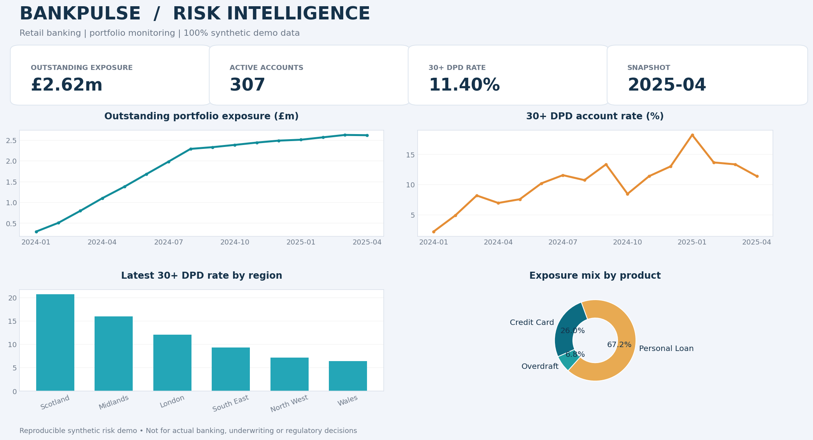
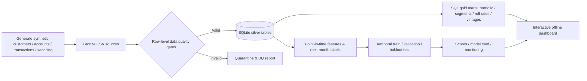

# 🏦 BankPulse — Retail Banking Risk & Customer Intelligence

**An end-to-end banking analytics portfolio project:** deterministic synthetic data → validated batch ingestion → SQL data marts → time-aware delinquency model → interactive executive dashboards → automated tests.

> **Portfolio demonstration, not an actual banking platform.** Every customer, transaction and account is synthetic. No internal employer datasets, client details, model code or confidential information are included. Outputs and performance depend on the simulator, not real-world credit decisions.



## Why this project matters

A retail bank's Risk and Finance functions need an auditable way to answer: **Where is our portfolio deteriorating, which accounts may become 30+ days past due next month, and can we trust the data?** BankPulse builds a working, local-first data product to answer those questions while enforcing basic quality controls and respecting time-based model validation.

| Competency | Implemented proof |
|---|---|
| **Data analyst** | Monthly exposure and delinquency KPIs, roll rates, vintage analysis, region/product slices and Customer 360 |
| **Analytics engineer** | Multi-stage SQL transformations, named facts and dimensions, explicit grains and SQL window functions |
| **Data engineer** | Four raw source feeds, ingestion, schema/FK/uniqueness checks, quarantine, indexed SQLite marts, repeatable CLI |
| **Data scientist** | Month-ahead outcome, logistic-vs-random-forest validation, strict chronological holdout, precision, ROC AUC, PR AUC, Brier and score-based alerts |
| **Risk / governance** | Data dictionary, KPI definitions, lineage, issue report, model card, key limitations and controls |
| **Software engineering** | Reusable Python package, pytest, GitHub Actions CI, no secrets or external services |

**Technology:** Python 3.10+, pandas, NumPy, SQLite SQL, scikit-learn, Plotly, pytest; optional Streamlit. No Docker, database server, API key, AWS account or paid licence required.

## Architecture



The `.sql` analytical transformations and source rules are version-controlled. See [`docs/architecture.md`](docs/architecture.md) and [`docs/data_dictionary.md`](docs/data_dictionary.md).

## ⚡ Quick start — Mac and Windows

### 1. Extract the ZIP and open the project in a terminal

- **Mac:** Finder → extracted `bankpulse-retail-risk-platform` folder → right-click → New Terminal at Folder (or use `cd /path/to/...`).
- **Windows:** Open the extracted folder in File Explorer → click the address bar → type `cmd` and press Enter. (Python must be installed and available on PATH.)

### 2. Create a clean Python environment

**Mac / Linux**
```bash
python3 -m venv .venv
source .venv/bin/activate
python -m pip install -r requirements.txt
```

**Windows PowerShell**
```powershell
py -m venv .venv
.venv\Scripts\Activate.ps1
python -m pip install -r requirements.txt
```

If PowerShell prevents activation, use Command Prompt and `.venv\Scripts\activate.bat` instead. You can also use `run_mac_linux.sh` or `run_windows.bat` after reviewing them.

### 3. Run the complete pipeline (one command)

```bash
python run.py all
```

The default generates **1,200 fictional customers and 30 monthly snapshots**, loads validated tables, compares two supervised models, scores a strictly held-out period and writes an **offline, interactive** Plotly dashboard.

**Faster laptop demo** (use this first on a slower computer):
```bash
python run.py all --customers 250 --months 16
```

### 4. Open the dashboard and test the project

```bash
python -m webbrowser dashboard/index.html
python -m pytest -q
```

You can also simply **double-click `dashboard/index.html`** and open it in Safari, Chrome or Edge. It embeds its own chart JavaScript, so **the report works offline**.

Optional live dashboard (with working filters):
```bash
python -m pip install -r requirements-dashboard.txt
streamlit run app/streamlit_app.py
```

The interactive Streamlit web UI is optional; the **offline Plotly HTML is part of the standard pipeline**.

### Where are the real outputs?

| Path after running | What it contains |
|---|---|
| `data/raw/*.csv` | Four generated fictional sources, with deliberate test errors |
| `warehouse/bankpulse.sqlite` | Clean customer/account/transaction/servicing tables, checks and analytics views |
| `reports/data_quality.json` | Rejected rows and all executed validation rules |
| `reports/model_metrics.json` | Exact train/validation/test months, selected algorithm and holdout performance |
| `reports/MODEL_CARD.md` | Auditable model assumptions and limitations |
| `models/early_warning_model.joblib` | Refit model pipeline, ready to load locally |
| `dashboard/index.html` | Self-contained interactive executive dashboard |
| `demo/sample_dashboard.html` | Ready-made smaller demo; works **before installing Python** |

Generated source CSVs, SQLite warehouse, model binaries and reports are intentionally `.gitignore`d to keep GitHub clean. The `demo/` folder provides version-controlled small sample outputs.

## 🎯 Five-minute interview walkthrough

1. **Business challenge:** “Risk management needs a reliable month-end view of exposure and emerging arrears.”
2. **Engineering:** Show `src/bankpulse/pipeline.py` (source contracts, row quarantine) and `sql/01_analytics_marts.sql` (partitioned windows, roll rates, lineage).
3. **Analytics:** Open `dashboard/index.html`, walk through portfolio balance, 30+ DPD percentages and segments, then show a SQL query.
4. **Data science:** Open `reports/MODEL_CARD.md`. Explain why using a **time-based** test matters and why the next month's DPD must *never* appear among features.
5. **Controls:** Show `reports/data_quality.json`, `tests/`, and the green GitHub Actions workflow. Discuss what would change for genuine bank data.

See [`docs/interview_playbook.md`](docs/interview_playbook.md) for interview questions, sample answers, and a non-exaggerated CV description.

## Useful commands

```bash
python run.py generate              # raw synthetic CSV data only
python run.py build                 # quality gates, SQLite and SQL views
python run.py train                 # model comparison, holdout metrics and scores
python run.py report                # refresh offline dashboard
python run.py all --seed 123        # rebuild every step with a different seed
python run.py all --customers 750 --months 24
python -m pytest -q                 # integration, data contracts and leakage checks
```

**Each command is deterministic for a given seed.** `all` rebuilds the database from scratch; don't use it on a real dataset. The quality gate fails closed when the invalid-source-row rate breaches the configured limit (default 3%).

## Example analytical SQL

Open `warehouse/bankpulse.sqlite` using [DB Browser for SQLite](https://sqlitebrowser.org/) (optional) or Python's built-in `sqlite3`.

```sql
-- Portfolio movement and observed 30+ DPD incidence
SELECT snapshot_month, accounts, total_exposure_gbp, pct_accounts_30plus
FROM mart_portfolio_monthly ORDER BY snapshot_month;

-- Latest regional hotspots (not causal conclusions)
SELECT region, product_type, accounts, pct_accounts_30plus
FROM mart_risk_segment
WHERE snapshot_month=(SELECT MAX(snapshot_month) FROM fact_servicing)
ORDER BY pct_accounts_30plus DESC;

-- Delinquency bucket roll-forward, a useful Risk MI control
SELECT snapshot_month, from_bucket, to_bucket, accounts, roll_rate_pct
FROM mart_roll_rates WHERE from_bucket='Current' ORDER BY snapshot_month;
```

There are six gold analytical views and a point-in-time supervised feature view; most are driven by SQL windows, joining, aggregations and cohort logic. For six **additional interview-ready SQL queries**, run `python scripts/run_example_queries.py` after building the warehouse.

## 📤 Publish with GitHub Desktop (no Git commands needed)

1. Extract the ZIP to a permanent location, e.g. `Documents/GitHub/bankpulse-retail-risk-platform`.
2. Launch [GitHub Desktop](https://desktop.github.com/) and sign in.
3. Choose **File → Add local repository**, select that folder and click **Add Repository**. If Desktop says it is not yet a Git repository, click **Create a Repository Here**. Enter name `bankpulse-retail-risk-platform` and create it.
4. Inspect the changed files (especially `README.md`, `sql/`, `src/` and `tests/`); commit with a meaningful message like `Add end-to-end synthetic banking risk analytics platform`.
5. Click **Publish repository**, choose **Public** if it is intended as a public portfolio, and publish to your own account.
6. Open the repository on github.com → **Actions** → verify the `Python ETL, model and data-contract checks` workflow passes after the push.

**GitHub Actions runs the tests online.** The standard GitHub code page does not host the running Streamlit app; for an online live UI, deploy Streamlit separately or share the included offline HTML sample. Never upload actual employer or client records.

## Research and inspiration

The design follows recurring themes in late-2026 public portfolio examples and financial-services job adverts: end-to-end ELT, reproducible SQL, data quality, explicit contracts, governance, and ML monitoring. The approach is original scaffolding, not a copy of any repo. See [`docs/research_notes.md`](docs/research_notes.md) for dated source links and trade-offs.

## Responsible disclosure and honest presentation

This is an **AI-assisted starter project**. Review and understand every script before describing it as your own hands-on work. Add your own architectural decisions, analytical investigation, performance improvements and written insights. Treat the model's results as a **synthetic demonstration**, not independently validated predictive power. See [`docs/limitations_and_next_steps.md`](docs/limitations_and_next_steps.md).

MIT licensed; credit contributors according to the licence.
